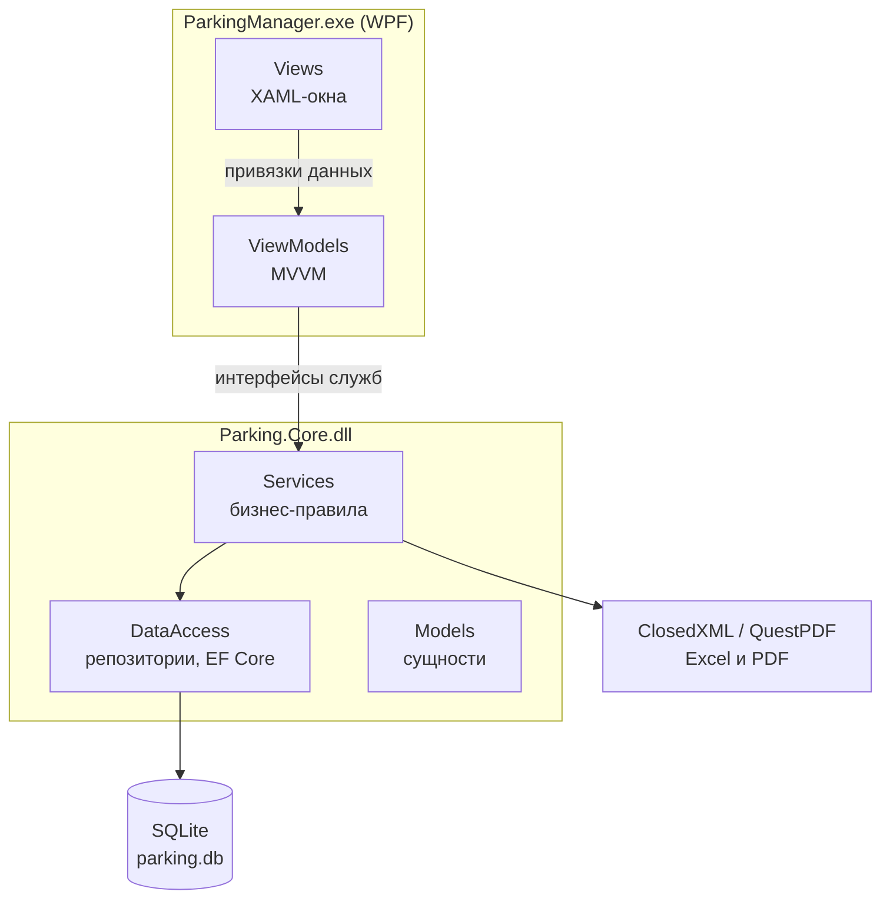
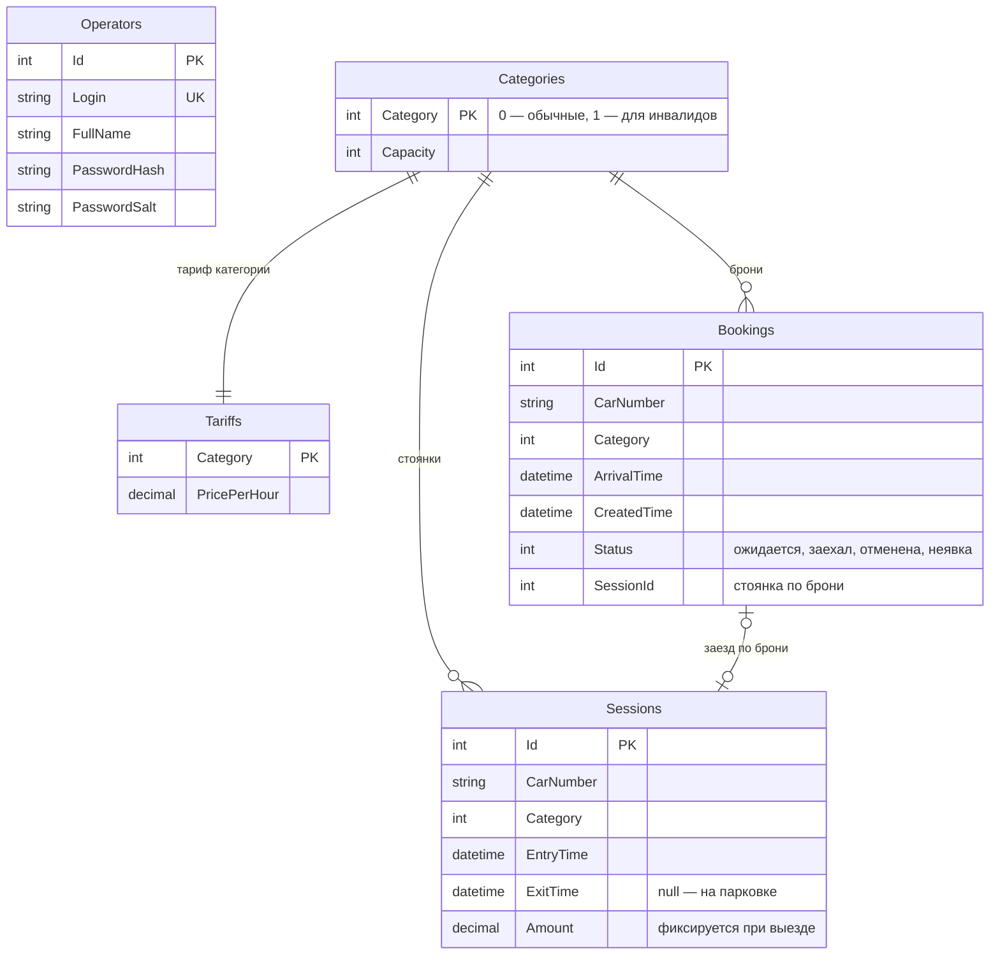
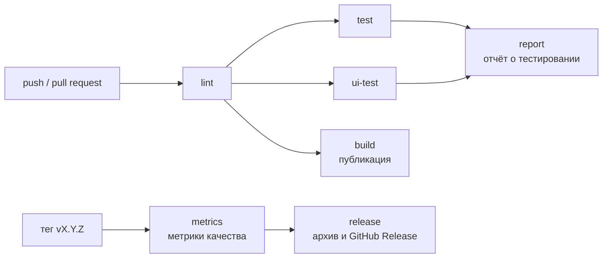

# Архитектура ParkingManager

## 1. Общая схема

Приложение — настольная программа Windows для одного пользователя (оператора) с локальной базой данных.
Код разделён на два проекта и три слоя:

| Проект | Содержимое | Зависит от |
|---|---|---|
| `ParkingManager` | окна (XAML), модели представления, конвертеры, окно «Сохранить как» | `Parking.Core`, WPF |
| `Parking.Core` | модели, службы, репозитории, контекст EF Core, экспорт отчётов | EF Core SQLite, ClosedXML, QuestPDF |

`Parking.Core` не знает о WPF, поэтому вся бизнес-логика проверяется модульными тестами без окон.

## 2. Слой представления (MVVM)

| Класс | Назначение |
|---|---|
| `ViewModelBase` | `INotifyPropertyChanged`, метод `SetProperty` |
| `RelayCommand` | команда кнопки: действие и условие доступности |
| `LoginViewModel` | вход оператора, событие `LoginSucceeded` |
| `MainViewModel` | счётчики, въезд и выезд, список и поиск; содержит модели вкладок |
| `BookingsViewModel`, `HistoryViewModel`, `ReportsViewModel`, `SettingsViewModel` | вкладки главного окна |
| `SessionViewModel`, `BookingViewModel`, `OccupancyViewModel`, `Report*ViewModel` | строки списков и карточки |
| `MoneyFormat`, `DurationFormat`, `CellStateToBrushConverter` | форматирование и цвета |

Окна не содержат логики: код окна только задаёт `DataContext` и запускает таймер обновления (30 с).
Модели представления получают службы через конструктор (внедрение зависимостей вручную),
окно «Сохранить как» скрыто за интерфейсом `ISaveFileDialog`, а время — за `TimeProvider`.
Благодаря этому модели представления тестируются без окон и с управляемым временем.

## 3. Слой бизнес-логики

| Служба | Ответственность |
|---|---|
| `AuthService` | проверка логина и пароля (`PasswordHasher`: PBKDF2-SHA256, 100 000 итераций, соль 16 байт) |
| `ParkingService` | занятость по категориям, въезд, выезд, расчёт суммы, история |
| `BookingService` | создание и отмена броней |
| `SettingsService` | вместимость категорий и тарифы |
| `ReportService` | отчёт за период |
| `ReportExporter` | выгрузка отчёта в Excel и PDF |

Вспомогательные классы: `CarNumberFormat` (приведение и проверка номера), `TariffCalculator`
(оплачиваемые часы), `BookingRules` (правило неявки), `ParkingClock` (время с точностью до минуты),
`ReportText` (форматирование для PDF).

Нарушение бизнес-правила — исключение `ParkingOperationException` с текстом для оператора.
Модели представления перехватывают только его и показывают текст в строке сообщений;
ошибки ввода-вывода при сохранении отчёта (`IOException`, `UnauthorizedAccessException`)
обрабатываются отдельно. Неверные аргументы конструкторов (`null`) приводят к
`ArgumentNullException` сразу при запуске.

`CoreServices` — точка сборки: создаёт контекст базы, репозитории и службы и отдаёт
приложению только интерфейсы служб.

## 4. Модель данных

Индексы: `Sessions(CarNumber)`, `Sessions(EntryTime)`, `Sessions(ExitTime)`,
`Bookings(Status)`, `Bookings(ArrivalTime)`, уникальный `Operators(Login)`.

База создаётся `DatabaseInitializer` при первом запуске: схема, демо-оператор,
категории 450 + 50 и тарифы 60 ₽ / 0 ₽. Версия схемы хранится в `PRAGMA user_version`.

### Решение по модели учёта мест

В плане (ЛР1–ЛР4) парковка моделировалась как набор отдельных мест со статусами.
На этапе 3 модель упрощена: оператор не фиксирует, на каком месте стоит автомобиль,
поэтому учёт ведётся по **категориям**. Свободные места категории = вместимость − занятые − удержанные бронями.
Это убрало таблицу мест, упростило въезд (не нужно выбирать место) и бронирование
(бронь удерживает место категории, конфликтов по конкретному месту нет).

## 5. Ключевые сценарии

**Въезд** (`ParkingService.RegisterEntry`): привести и проверить номер → проверить, что
автомобиля нет на парковке → снять просроченные брони → если есть бронь, взять её категорию →
проверить свободное место (занятые + брони других < вместимости) → создать стоянку →
отметить бронь «заехал».

**Выезд** (`RegisterExit`): найти активную стоянку → время выезда → сумма по действующему тарифу
(`TariffCalculator`: каждый начатый час, минимум 1 час) → сохранить.

**Бронь** (`BookingService.CreateBooking`): проверить номер → время сегодня и не в прошлом →
автомобиль не на парковке → у номера нет ожидающей брони → в категории есть свободное место → создать.

## 6. Качество и автоматизация

| Средство | Назначение |
|---|---|
| Анализаторы .NET (`latest-recommended`), StyleCop, `.editorconfig` | правила кода и стиля, проверяются при сборке и в CI |
| `dotnet format` | форматирование, проверка в CI (`lint`) |
| xUnit, FlaUI | модульные, интеграционные и UI-тесты, метки `Category` и `Task` |
| coverlet, ReportGenerator | покрытие строк и ветвлений; сгенерированный код исключён (`tests/coverage.runsettings`) |
| Conventional Commits, commitlint, хук `.githooks/commit-msg` | формат сообщений коммитов |
| Git Flow, защита веток, pull request | `feature/*` → `develop` → `release-*` → `main` |

Пайплайны GitHub Actions:

| Workflow | Когда | Что делает |
|---|---|---|
| `ci.yml` | push и pull request | lint → test + ui-test → report, build |
| `commitlint.yml` | push и pull request | проверка сообщений коммитов |
| `release.yml` | тег `v*` | метрики, публикация `ParkingManager-vX.Y.Z.zip` в GitHub Releases |
| `metrics.yml` | из `release.yml` или вручную | предупреждения, сложность, покрытие, тесты, git- и CI-метрики |

## 7. Ограничения версии 1.0

- Один оператор и одна рабочая станция; база локальная.
- Брони только на текущий день.
- При изменении версии схемы (до 1.0 — при каждом этапе) демо-база пересоздаётся;
  для дальнейших версий нужны миграции EF Core.
