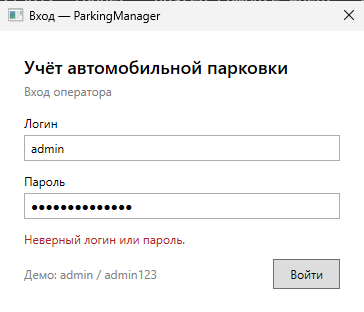
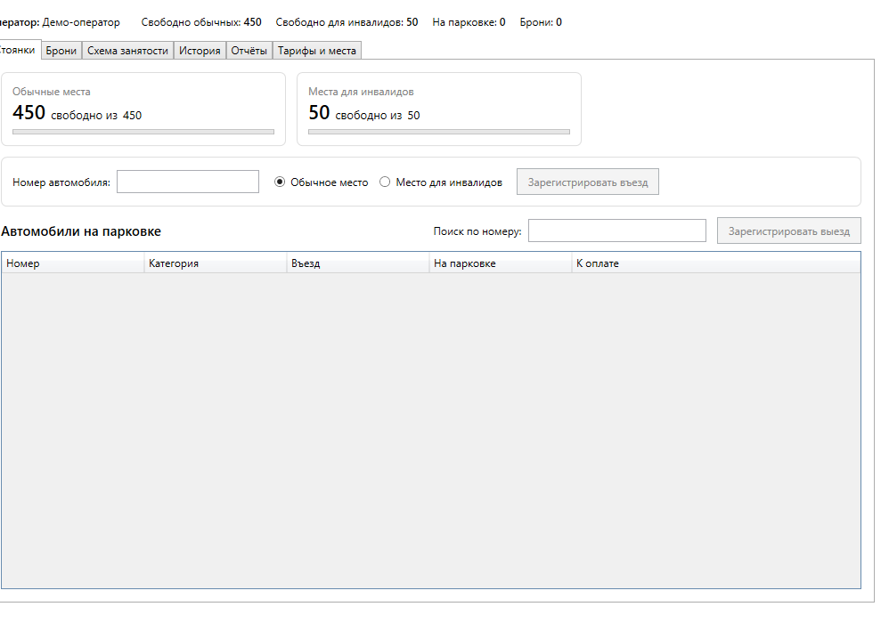
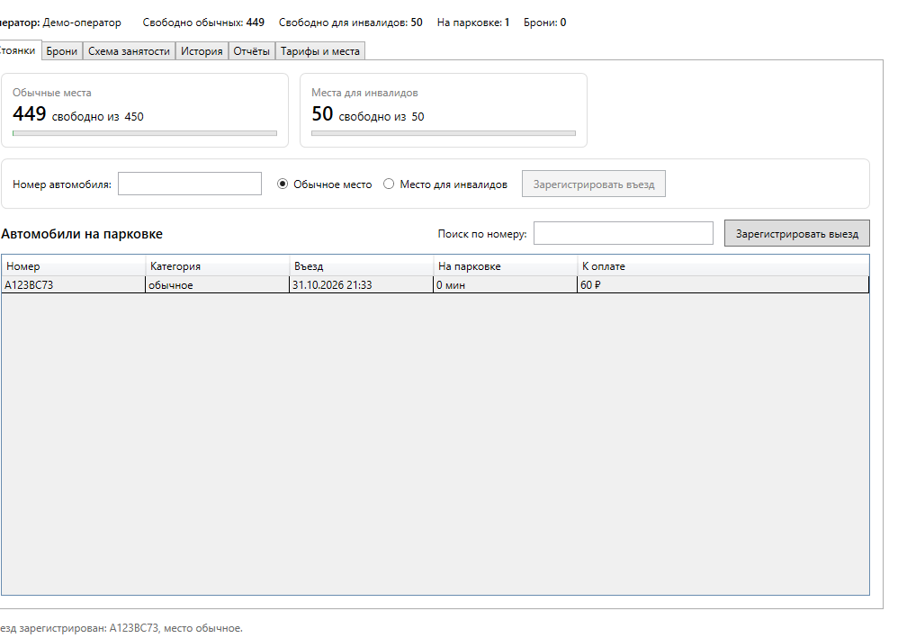
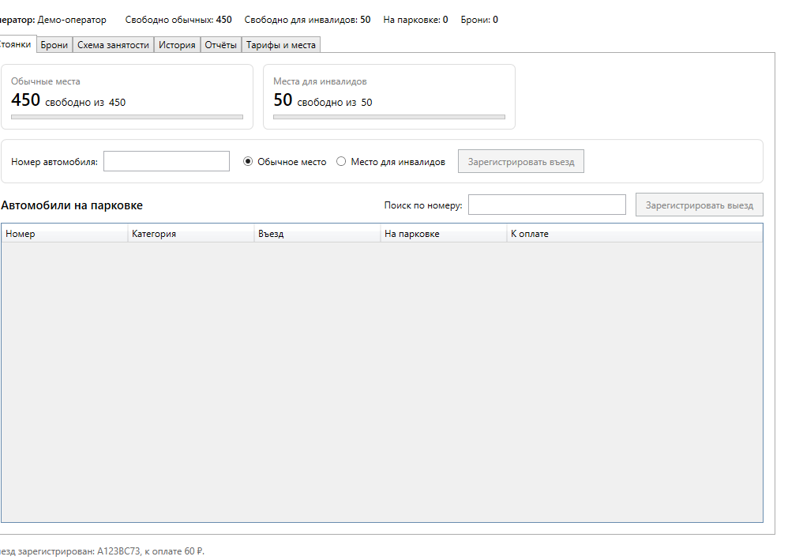
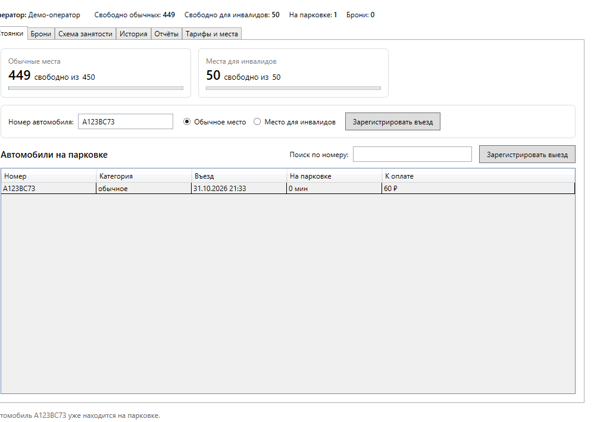
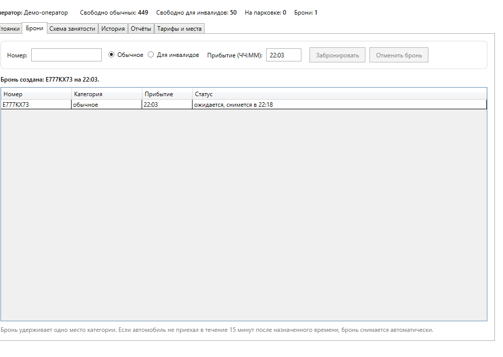
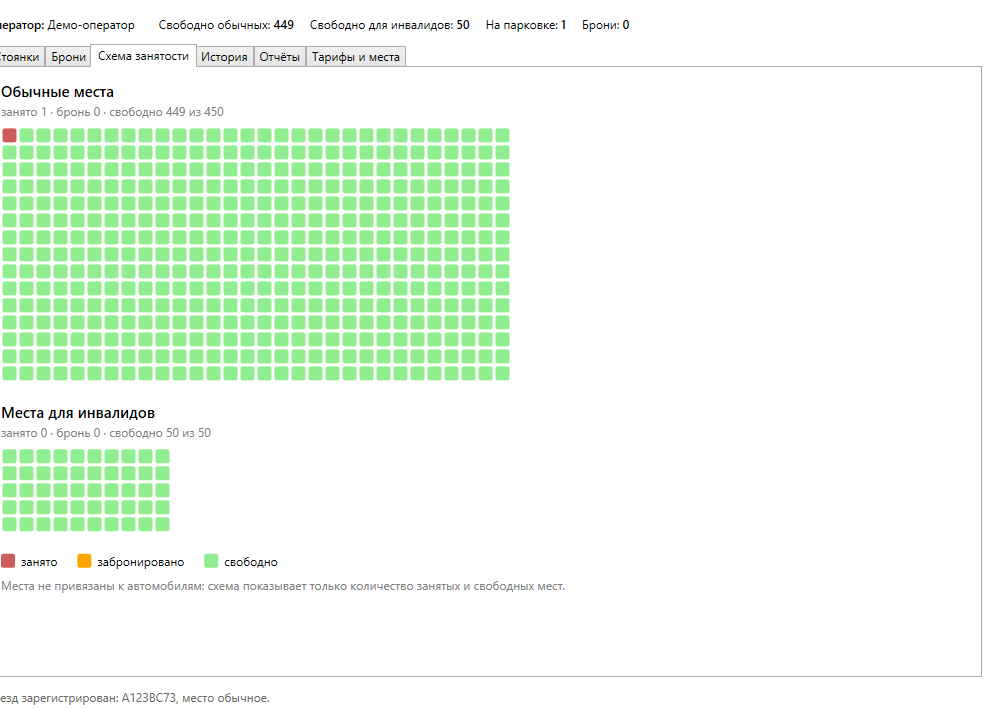
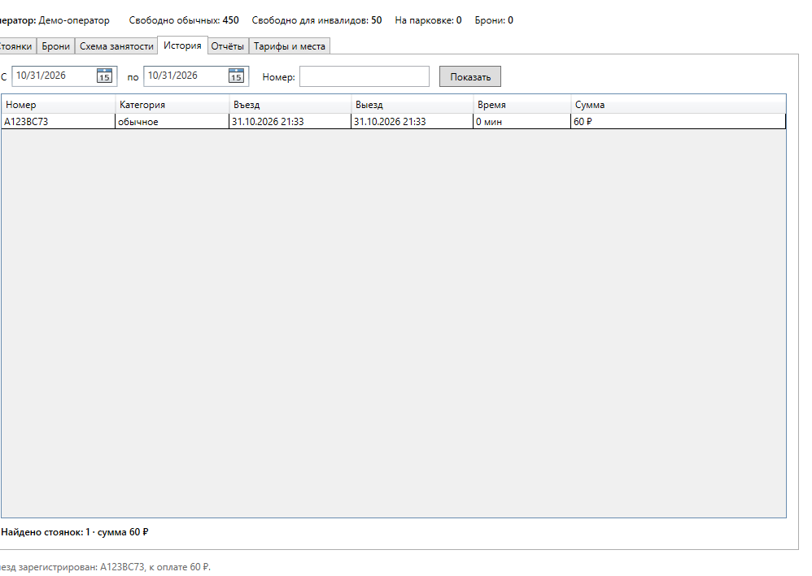
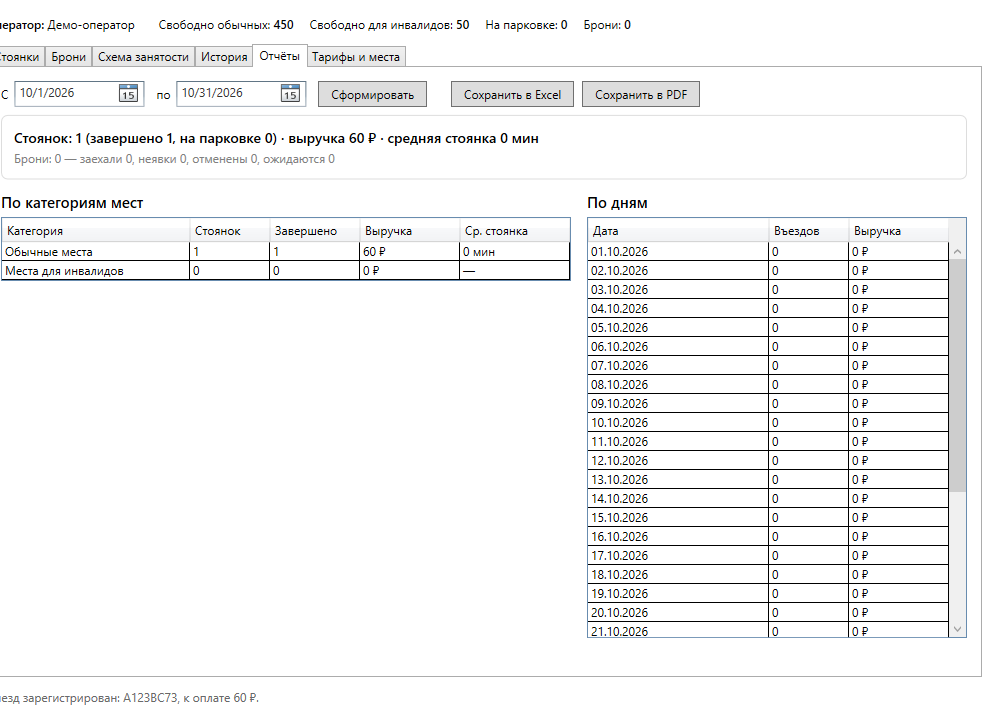
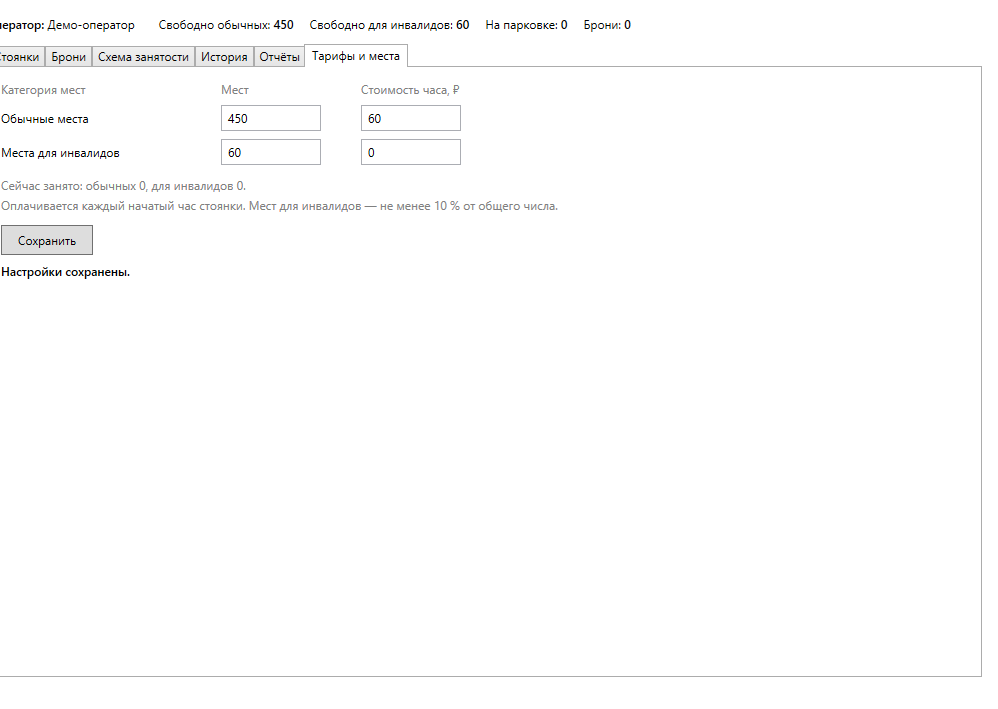

# Руководство оператора ParkingManager

Версия 1.0. Приложение предназначено для одного пользователя — оператора парковки.

## Содержание

1. [Вход в программу](#1-вход-в-программу)
2. [Главное окно](#2-главное-окно)
3. [Стоянки: въезд и выезд](#3-стоянки-въезд-и-выезд)
4. [Брони](#4-брони)
5. [Схема занятости](#5-схема-занятости)
6. [История](#6-история)
7. [Отчёты](#7-отчёты)
8. [Тарифы и места](#8-тарифы-и-места)
9. [Правила работы парковки](#9-правила-работы-парковки)
10. [Сообщения об ошибках](#10-сообщения-об-ошибках)
11. [Данные программы](#11-данные-программы)

## 1. Вход в программу

Запустите `ParkingManager.exe`, введите логин и пароль и нажмите **Войти** (или Enter).
Демо-оператор: логин **admin**, пароль **admin123**.

При неверных данных появляется сообщение «Неверный логин или пароль.», главное окно не открывается.

## 2. Главное окно

В верхней строке всегда видны: оператор, свободные обычные места, свободные места
для инвалидов, число автомобилей на парковке и число активных броней.
Внизу окна — строка сообщений: результат последней операции или причина отказа.

Данные обновляются сразу после каждой операции и дополнительно раз в 30 секунд —
так вовремя снимаются просроченные брони.

Вкладки: **Стоянки**, **Брони**, **Схема занятости**, **История**, **Отчёты**, **Тарифы и места**.

## 3. Стоянки: въезд и выезд

### Въезд

1. Введите номер автомобиля в поле **Номер автомобиля**, например `А123ВС73`.
   Регистр, пробелы и латинские буквы-двойники не важны: `a 123 bc 73` будет записан как `А123ВС73`.
2. Выберите категорию: **Обычное место** или **Место для инвалидов**.
3. Нажмите **Зарегистрировать въезд**.

Автомобиль появится в списке «Автомобили на парковке», счётчик свободных мест уменьшится.
Если на этот номер есть бронь, категория берётся из брони, а бронь отмечается как «заехал».

### Выезд

1. Найдите автомобиль: введите часть номера в поле **Поиск по номеру**
   (если найден один автомобиль, он выделяется автоматически) или выберите строку в списке.
2. Нажмите **Зарегистрировать выезд**.

В строке сообщений появится сумма к оплате, например «Выезд зарегистрирован: А123ВС73, к оплате 120 ₽.».
В списке для каждого автомобиля видно время въезда, длительность стоянки и сумму на текущий момент.

Повторный въезд автомобиля, который уже на парковке, не регистрируется:

## 4. Брони

Бронь оформляется по обращению клиента **на сегодня**.

1. Введите номер автомобиля, выберите категорию места и время прибытия в формате **ЧЧ:ММ**
   (по умолчанию предлагается время через 30 минут).
2. Нажмите **Забронировать**.

Бронь удерживает одно место своей категории: свободных мест становится на одно меньше.
Статус брони в списке:

| Статус | Значение |
|---|---|
| ожидается, снимется в ЧЧ:ММ | место удерживается до времени прибытия + 15 минут |
| заехал | автомобиль въехал по брони |
| отменена | оператор отменил бронь |
| снята — неявка | автомобиль не приехал в течение 15 минут, место освобождено |

**Приезд по брони** — это обычная регистрация въезда на вкладке «Стоянки»: программа сама
найдёт бронь по номеру. Автомобиль с бронью заезжает, даже если свободных мест уже нет:
место было удержано для него.

**Отмена:** выделите бронь со статусом «ожидается» и нажмите **Отменить бронь**.

## 5. Схема занятости

Каждый квадратик — одно место: красный — занято, оранжевый — забронировано, зелёный — свободно.
Квадратики заполняются по порядку, конкретное место автомобиля не отслеживается.
Обычные места — сетка 30 × 15, места для инвалидов — 10 × 5.

## 6. История

Выберите период (**С** … **по**), при необходимости часть номера, и нажмите **Показать**.
В список попадают стоянки с въездом в выбранном периоде — завершённые и ещё идущие.
Внизу показано число стоянок и общая сумма.

## 7. Отчёты

1. Выберите период (по умолчанию — с начала месяца по сегодня) и нажмите **Сформировать**.
2. Просмотрите итоги: число стоянок (завершено и на парковке), выручку, среднюю длительность
   стоянки, брони по статусам; таблицы **По категориям мест** и **По дням**.
3. Нажмите **Сохранить в Excel** или **Сохранить в PDF** и выберите файл.

В Excel три листа: «Сводка», «По категориям», «По дням». PDF подходит для печати.
Стоянка относится к периоду по дате въезда, выручка — сумма, оплаченная при выезде.
Период отчёта — не более 366 дней.

Если файл открыт в другой программе, появится сообщение «Не удалось сохранить отчёт: …» —
закройте файл и сохраните снова.

## 8. Тарифы и места

Здесь меняются вместимость категорий и стоимость часа. После изменения нажмите **Сохранить**.

- Вместимость нельзя сделать меньше числа занятых и забронированных мест.
- Мест для инвалидов — не менее 10 % от общего числа и не менее одного.
- Стоимость часа — от 0 до 10 000 ₽, дробная часть через запятую или точку (`75,5`).
- Новый тариф применяется ко всем ещё не оплаченным стоянкам.

## 9. Правила работы парковки

| Правило | Значение |
|---|---|
| Категории мест | обычные (по умолчанию 450) и для инвалидов (по умолчанию 50, не менее 10 %, 181-ФЗ, ст. 15) |
| Формат номера | буква, три цифры, две буквы, код региона из 2–3 цифр; буквы только А, В, Е, К, М, Н, О, Р, С, Т, У, Х |
| Оплата | каждый начатый час, минимум 1 час; обычное место — 60 ₽/ч, место для инвалидов — бесплатно |
| Время | фиксируется с точностью до минуты |
| Бронь | только на сегодня; одна активная бронь на автомобиль; удерживается 15 минут после времени прибытия |

## 10. Сообщения об ошибках

| Сообщение | Причина и что делать |
|---|---|
| Не указан номер автомобиля. | поле номера пустое |
| Номер автомобиля указан неверно. Пример: А123ВС73. | номер не соответствует формату РФ или содержит недопустимую букву (например, П) |
| Автомобиль … уже находится на парковке. | въезд этого номера уже зарегистрирован — найдите его в списке и оформите выезд |
| Свободных мест нет (…). | в выбранной категории все места заняты или удержаны бронями |
| Выезд автомобиля … уже зарегистрирован. | стоянка уже завершена — обновите список |
| Бронировать можно только на сегодня. / Время прибытия уже прошло. | укажите время в пределах текущего дня, не раньше текущего |
| У автомобиля … уже есть бронь на ЧЧ:ММ. | у номера есть ожидающая бронь — отмените её или дождитесь приезда |
| Свободных мест для брони нет (…). | в категории нет свободных мест |
| Бронь уже не активна. | бронь уже отменена, использована или снята по неявке |
| Дата окончания периода раньше даты начала. | поменяйте даты в истории или отчёте местами |
| Мест для инвалидов должно быть не менее 10 % … | увеличьте число мест для инвалидов |
| Не удалось сохранить отчёт / Нет доступа к файлу | файл открыт в другой программе или папка недоступна для записи |

## 11. Данные программы

Все данные хранятся локально в файле базы SQLite
`%LOCALAPPDATA%\ParkingManager\parking.db`. Для резервной копии достаточно
скопировать этот файл при закрытой программе.
